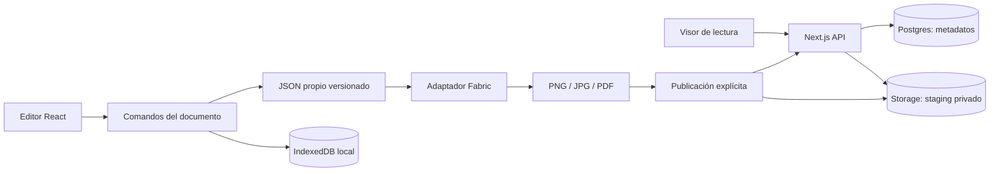

# Arquitectura del editor personal

**Estado de implementación:** la edición construida usa IndexedDB para originales y un repositorio Node de archivos privados para publicaciones, con una instancia y disco persistente. Las secciones Supabase/SQL de este documento conservan la propuesta inicial, no la configuración activa. Ver backend.md para el ajuste, las 9 operaciones HTTP reales, el acceso del propietario y los límites. Las familias de fuentes son del sistema; los grupos son planos. No se ha configurado infraestructura externa.

Fecha: 20 de octubre de 2026. Entradas: recon.md y features.csv de esta carpeta. Alcance: editor web individual de diseños estáticos, plantillas propias, varias páginas, guardado, PNG/JPG/PDF y enlaces revocables de lectura. Este documento define la implementación; todavía no hay aplicación ni infraestructura desplegada.

## Decisiones y stack

| Capa | Elección | Motivo |
| --- | --- | --- |
| Aplicación | Next.js App Router, React y TypeScript | Una aplicación para editor, visor y seis endpoints de publicación |
| Interfaz | CSS Modules y variables de diseño | Pocos componentes; tokens que definirá replica-design |
| Lienzo | Fabric.js, cargado solo en cliente | Objetos, cajas de texto, selección y transformaciones ya disponibles |
| Documento | JSON propio validado con Zod | Evitar depender del formato interno de una biblioteca |
| Guardado | IndexedDB mediante Dexie | Documentos y blobs locales; transacciones de guardado |
| Exportación | Fabric StaticCanvas + pdf-lib; ZIP para varias imágenes | Compartir el mismo renderizador entre vista y exportación |
| Publicación | Postgres, Auth y Storage privado de Supabase | Solo para enlaces y páginas publicadas; sin sincronización de originales |
| Procesado de imágenes publicadas | sharp en servidor Node | Verificar dimensiones y recodificar los PNG antes de servirlos |
| Acceso | Sin cuenta para editar; cuenta del propietario para publicar | Eliminar registro del recorrido principal |
| Alojamiento | Next.js en Node/Docker; servicio gestionado al activar enlaces | Permite usar sharp y ejecutar la limpieza en el mismo servicio |
| Pagos, email comercial y webhooks | No necesarios | Uso individual, sin suscripción propia ni integraciones |

Elegir versiones estables compatibles al iniciar el proyecto y fijarlas en el lockfile; no se prescriben números de versión sin probar el conjunto. Cuenta de publicación precreada en Supabase; acceso por contraseña mediante su SDK, registro público deshabilitado y UUID del propietario permitido en configuración del servidor. Las credenciales las introduce el usuario en el formulario. El servicio rechaza cualquier otro UUID aunque su JWT sea válido. No configurar servicios durante esta fase.

La documentación oficial respalda las capacidades utilizadas: [Fabric.js](https://www.fabricjs.com/docs/), [Dexie con React](https://dexie.org/docs/Tutorial/React), [pdf-lib](https://pdf-lib.js.org/), [Next.js en Node o Docker](https://nextjs.org/docs/app/getting-started/deploying), [Storage y permisos](https://supabase.com/docs/guides/storage/security/access-control), [subidas firmadas](https://supabase.com/docs/reference/javascript/storage-from-createsigneduploadurl) y [salida PNG con sharp](https://sharp.pixelplumbing.com/api-output/). Estas elecciones son propias, no una descripción del stack de Canva.

## Límites entre módulos

Carpetas propuestas: `src/editor/{document,commands,fabric}`, `src/local`, `src/export`, `src/publication`, `src/server` y `src/app`. Los módulos de editor y guardado no importan el SDK remoto. El modo sin configuración remota permite todas las funciones locales y explica en S11 qué falta para activar enlaces.

## Documento y renderizado

Documento v1: `{schemaVersion:1,id,title,width,height,pages:[{id,background,elements:[]}],assetIds:[]}`. Todas las páginas comparten tamaño; medidas en píxeles lógicos. Elementos: texto, imagen, rectángulo, círculo y grupo. Campos comunes: UUID, posición, tamaño, rotación, opacidad, bloqueo y orden por posición en array. Texto: contenido plano, familia permitida, tamaño, peso, color, alineación e interlineado. Imagen: assetId y recorte. Grupo: hijos y transformación local, con profundidad máxima de 5.

No almacenar objetos vivos de Fabric, URLs blob ni URL externas como referencia persistente. El adaptador convierte JSON validado a objetos Fabric y los comandos actualizan el documento. Una operación de arrastre es un comando al terminar el gesto; la escritura agrupa cambios próximos. Deshacer/rehacer mantiene hasta 100 comandos en memoria; una edición nueva limpia rehacer. El historial de comandos no se conserva al recargar; las revisiones guardadas sí.

Antes de exportar: terminar edición de texto, guardar revisión, esperar fuentes y decodificación de imágenes, y renderizar una copia inmutable con StaticCanvas sin guías ni selección. PNG mantiene alfa; JPG compone sobre el fondo de página o blanco. Varias páginas PNG/JPG producen ZIP. PDF inserta una imagen por página con pdf-lib; conversión px→pt a 96 px por pulgada. Es PDF rasterizado: no ofrece texto seleccionable, vectores, CMYK ni garantía de impresión profesional. La resolución puede aumentarse dentro del límite de píxeles.

Fuentes iniciales locales con licencia redistribuible y repertorio español. El catálogo guarda familia y versión de fuente; falta de fuente bloquea exportación hasta elegir sustitución explícita. Ningún recurso de Canva se incluye.

## Persistencia local: siete almacenes

IndexedDB es la única base del documento editable. Postgres almacena exclusivamente publicaciones. No son dos copias sincronizadas del mismo diseño.

| Store | Clave, índices y datos | Invariantes |
| --- | --- | --- |
| designs | id; updatedAt, folderId; document, revision, thumbnail | Al menos una página; propietario es el perfil del navegador |
| revisions | id; [designId+sequence], createdAt; snapshot | Secuencia única; conservar últimas 20 por diseño |
| assets | id; hash, createdAt; Blob, mime, dimensions, licenseNote | Hash SHA-256 para deduplicar; no borrar si una revisión retenida lo usa |
| templates | id; title, *tags; document, bundledAssetIds, provenance | Solo plantillas propias/licenciadas; instanciar crea nuevos IDs |
| folders | id; name, updatedAt | Carpetas planas; borrar carpeta conserva diseños sin carpeta |
| publications | id; designId, status, updatedAt; revision, requestId, token, manifest | Estado del cliente y reintentos; publicación no altera documento |
| settings | key; value | Perfil local, paleta, preferencias y versión del formato |

Fechas locales como ISO UTC y UUID por Web Crypto. IndexedDB no impone FKs: el repositorio valida referencias y elimina diseño/revisiones en una transacción; limpieza de blobs solo después de calcular referencias de diseños y revisiones. Cada guardado compara `expectedRevision` y actualiza diseño + revisión atómicamente. Si difiere, devolver conflicto y abrir copia recuperable, sin sobreescribir. Dos pestañas: Web Locks cuando exista, BroadcastChannel para avisos y comparación de revisión como garantía final.

Guardar tras 500 ms de inactividad y al terminar gestos. «Guardado» aparece solo tras commit. Un cierre puede perder los últimos cambios aún pendientes; no depender de unload para escribir. Si falla por cuota, conservar estado en memoria y permitir descargar respaldo. El respaldo ZIP incluye JSON, blobs y manifiesto de hashes; importación valida tamaño, formato y rutas antes de crear una copia. Cambios de esquema usan migraciones Dexie y una copia exportable antes de cambios destructivos.

Solicitar persistencia con Storage API y mostrar consumo aproximado. El almacenamiento del navegador puede borrarse o quedar sin espacio: la copia descargable es necesaria. El origen, perfil del navegador y puerto identifican el almacenamiento; mover de localhost a un dominio exige exportar/importar. [Cuotas y persistencia, MDN](https://developer.mozilla.org/en-US/docs/Web/API/Storage_API/Storage_quotas_and_eviction_criteria). Reapertura local funciona mientras la aplicación esté disponible; carga completamente offline mediante service worker queda para una fase posterior.

## Esquema remoto: tres tablas

SQL en schema.sql, destinado a Supabase Postgres, con RLS. Tablas: profiles, publications y publication_pages. Los conceptos Page, Element, Template y Revision del recon viven dentro del documento y los stores locales; no se convierten en tablas remotas. ExportJob es una tarea local cancelable, sin cola remota.

El perfil remoto se provisiona para un único usuario existente. Todas las filas llevan user_id, UUID, fechas UTC, restricciones y reglas de borrado. Las FK compuestas impiden asignar una página a una publicación de otro propietario. `updated_at` se mantiene mediante trigger. RLS concede lectura al propietario; las escrituras remotas solo las hace la capa de servidor después de validar JWT y propietario permitido. No hay acceso anónimo SQL ni acceso directo público al bucket. La clave service_role nunca llega al cliente.

## Rutas de interfaz y flujos locales

Cinco rutas UI: `/` (S01/S03), `/templates` (S04/S05), `/editor/[id]` (S06–S12), `/settings` (respaldo y acceso S02) y `/s` (S13). El lienzo está en un Client Component; SSR no toca IndexedDB.

| Flujo | Operación interna; llamante | Entrada → salida | Persistencia |
| --- | --- | --- | --- |
| F01 | listTemplates / instantiateTemplate; usuario local | búsqueda o templateId → lista o designId | templates/assets/designs/revisions |
| F02 | dispatch(EditText/SetStyle/Duplicate/Delete); usuario local | designId y comando → revisión en memoria | designs/revisions al guardar |
| F03 | importAsset / replaceImage; usuario local | File PNG/JPG/WebP → assetId y elemento | assets/designs/revisions |
| F04 | addElement; usuario local | tipo y propiedades → elementId | designs/revisions |
| F05 | add/duplicate/delete/reorderPage; usuario local | pageId y posición → documento validado | designs/revisions |
| F06 | saveDesign / openDesign / exportBackup / importBackup; usuario local | expectedRevision y snapshot → revisión o conflicto | designs/revisions/assets |
| F07 | renderExport; usuario local | revisión, formato, pageIds y escala → Blob/ZIP/PDF | sin filas remotas |
| F08 | preparePublication / revokePublication; propietario remoto | revisión, páginas y token → publicación o revocación | store publications + tres tablas remotas |

F01–F07 no necesitan HTTP ni autenticación. No crear endpoints de guardado que enviaran documentos a un servidor innecesariamente.

## API de publicación: seis operaciones HTTP

Errores comunes: 400 entrada inválida, 401 sesión ausente, 403 propietario no permitido, 404 recurso no accesible, 409 conflicto de estado/idempotencia, 413 límite y 429 frecuencia. Respuestas sin secretos y errores con requestId.

| Método / ruta | Acción y autorización | Entrada | Salida | Flujo |
| --- | --- | --- | --- | --- |
| POST /api/publications | Reservar instantánea; JWT del propietario | requestId, manifestHash, tokenHash, designId local, revision, título, páginas con UUID/tamaño/hash/bytes | id, estado y URLs firmadas de staging | F08 |
| POST /api/publications/[id]/finalize | Verificar y activar; propietario del id | id; manifiesto ya reservado | ready o error recuperable | F08 |
| GET /api/publications/[id] | Consultar reintento; propietario del id | id | estado y metadatos propios | F08 |
| DELETE /api/publications/[id] | Revocar; propietario del id | id | 204; idempotente | F08 |
| GET /api/share | Leer manifiesto público autorizado por token | Authorization: Share token | título y páginas; nunca original editable | F08 |
| GET /api/share/pages/[pageId] | Servir PNG si pertenece a la publicación del token | mismo header y pageId | bytes image/png | F08 |

Las URLs firmadas de subida usan el API oficial de Storage, no un séptimo endpoint propio. El cliente sube archivos directamente al bucket privado. La app no consume ninguna API de Canva. Webhooks de entrada y salida: ninguno.

### Publicación, privacidad y reintentos

1. Guardar una revisión y elegir páginas explícitamente. Renderizar solo esas páginas. El enlace publica imágenes visibles; no JSON, historial, recursos originales, texto oculto ni áreas fuera del recorte.
2. Generar 32 bytes aleatorios como token y persistirlo con requestId en IndexedDB antes de enviar. Transmitir solo SHA-256 del token al reservar; el hash no es una credencial de lectura. El manifiesto hasheado incluye páginas, hashes, título, revisión y tokenHash.
3. Reservar publicación `draft` y filas de páginas en una transacción. Repetir requestId + mismo manifiesto devuelve el mismo id; diferente manifiesto devuelve 409. Si faltan subidas, emitir nuevas URLs para las rutas staging asignadas, sin upsert.
4. Subir a `userId/publicationId/staging/pageId.png`. El bucket acepta PNG con límite por archivo. La URL firmada solo autoriza staging; su expiración no se usa como mecanismo de revocación del enlace.
5. Finalize valida propietario, estado, cantidad, hashes, bytes y dimensiones reales. Recodifica con sharp, sin metadatos, a claves distintas e inmutables `.../ready/pageId.png`. Restringir decodificación por píxeles. Solo después actualizar rutas, verified_at y estado a ready en una transacción. Una subida posterior a staging no modifica archivos ready.
6. Compartir `/s#TOKEN`. El fragmento se lee en cliente; peticiones públicas llevan el token en header. No registrar Authorization ni hashes ni contenido de diseños; visor sin analítica externa y con Referrer-Policy: no-referrer. El token se conserva en el store local; perderlo exige revocar y generar otro enlace.
7. El servidor hashea el token y exige ready en cada acceso al manifiesto o página; no devuelve URLs firmadas de descarga. Respuestas `Cache-Control: private, no-store`, sin CDN ni caché de service worker. El visor obtiene blobs mediante fetch autenticado por token.
8. DELETE cambia a revoked antes de borrar archivos. Nuevas solicitudes quedan denegadas; bytes ya descargados o una petición ya autorizada no se pueden retirar. Cambiar el diseño no actualiza la publicación: crear nueva instantánea y revocar la anterior si se desea.

Finalizaciones simultáneas: lock asesor de Postgres por publicationId mantenido durante el proceso con conexión dedicada, y actualización final condicionada a draft; DELETE no necesita ese lock y prevalece frente a publicación pendiente. Una caída deja draft y archivos huérfanos limpiables. Reintento valida los ready ya creados o los reconstruye antes de activar. No reactivar revoked. Todos los cambios de estado pasan por una función de repositorio.

## Límites iniciales y operación

Límites propios configurables: 50 páginas por documento; 500 elementos por página; grupos hasta profundidad 5; PNG/JPG/WebP hasta 10 MiB y 16 megapíxeles por imagen local; 16 megapíxeles por página exportada; publicación hasta 10 páginas PNG, 5 MiB cada una y 20 MiB totales. Exportar secuencialmente y liberar canvases. Si un documento supera límites de publicación sigue siendo editable y exportable por archivo.

Validar magia del archivo, decodificación y dimensiones; no admitir SVG/HTML ni URL remota arbitraria en v1. Los títulos y textos nunca se insertan como HTML. Antes de importar un ZIP: máximo 200 MiB descomprimidos y 500 entradas, rechazar rutas ascendentes y esquemas desconocidos. Mostrar errores y alternativa de exportar por páginas cuando falte memoria.

Límites de API iniciales: 10 reservas/hora por propietario, una finalización simultánea por propietario y 120 lecturas/minuto por IP más presupuesto de bytes. Aplicarlos en el gateway del alojamiento con 429; validaciones de tamaño también en servidor. Una sola instancia Node inicial; no asumir que un contador en memoria sirva al escalar. Sin búsqueda remota: filtro local por títulos/tags normalizados.

Jobs del mismo servicio, sin microservicios: cada hora borrar staging y publicaciones draft/failed con más de 24 h, sin tocar finalizaciones con lock; borrar archivos de revoked; reintentar borrados fallidos. Conservar metadatos de revocación hasta purga completa. La tarea usa clave de servidor y lock para evitar duplicados; no exponer un cron público. Una desconexión no afecta edición local; compartir requiere red. Todas las fechas UTC, mostradas en hora local; no hay calendarios ni reglas de horario de verano. No hay dinero que modelar.

Borrado: eliminar documento local no revoca publicaciones automáticamente. Ofrecer ambas acciones en el diálogo; si falta red, marcar revocación pendiente, sin afirmar que terminó. Eliminar cuenta: revocar publicaciones, purgar objetos Storage y después borrar perfil/Auth; la cascada SQL no borra blobs. Respaldo y originales permanecen en el dispositivo hasta que el usuario los borre. No enviar métricas con contenido ni tokens.

## Orden de construcción y comprobación

| Hito | Pantallas y flujo | Stores/tablas y rutas | Evidencia de aceptación |
| --- | --- | --- | --- |
| M1: recorrido completo | S03–S07/S12; F01/F02/F06/F07 | designs/revisions/templates; UI /, /templates, /editor/[id]; sin SQL ni API | Plantilla propia con texto y forma → cambiar texto → guardar → recargar → PNG idéntico |
| M2: todos los must locales | S06–S10/S12; F02–F07 | assets y anteriores; sin SQL | Subir/sustituir imagen; mover/escalar/girar; duplicar/eliminar; deshacer/rehacer; multipágina; JPG/PDF y selección de páginas; respaldo/restauración |
| M3: must de compartir | S02/S11/S13; F08 | store publications; tres tablas SQL y seis operaciones HTTP; /settings, /s | Autenticar propietario; publicar solo páginas seleccionadas; invitado lee; revocar; reintentar sin duplicar |
| M4: should | S03/S06/S10; F04–F06 | folders y settings; sin API adicional | Carpetas, dimensiones, capas, agrupado/bloqueo, zoom y ajuste |
| M5: could | S07/S12 | settings; sin API adicional | Paleta/tipografías personales y control explícito del alfa |

Pruebas que justifican el riesgo: persistencia transaccional y conflicto entre pestañas; recuperación tras cuota agotada; acentos/saltos/rotación/recorte en exportación con imágenes de referencia; JPG con fondo; PDF con número y tamaño de páginas; respaldo con blobs; rechazo de token inválido y recursos de otra publicación; revocación concurrente con finalize; reintento de upload/finalize; ausencia de documentos y secretos en tráfico remoto. Probar con Chromium y Firefox de escritorio. Fabric requiere alternativas DOM para selección y propiedades por teclado; la accesibilidad no puede depender solo del canvas.

M1 debe probar viabilidad del texto y render antes de completar la interfaz. Si la fidelidad falla, resolver el adaptador antes de sumar funciones. No marcar filas de features.csv como implementadas durante planificación. replica-entrepreneur queda opcional para uso propio; sus hallazgos futuros entrarían después de los imprescindibles, con evidencia.

## Riesgos y siguiente paso

Los tres riesgos principales son coherencia de texto/exportación, pérdida de datos locales y aislamiento/revocación de publicaciones. El diseño reduce cada uno con renderizador compartido, transacciones + respaldo y páginas rasterizadas servidas tras comprobar estado.

Siguiente paso: **replica-design**, para definir identidad propia, tokens, componentes y estados de las pantallas del recon. Después replica-build comienza por M1. Este paquete es un diseño técnico revisado documentalmente; schema.sql requiere ejecutarse y probar RLS en un proyecto Supabase de desarrollo antes de considerarse migración validada.
